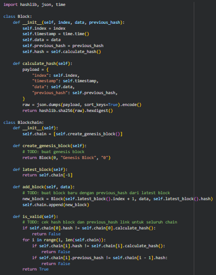
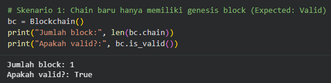
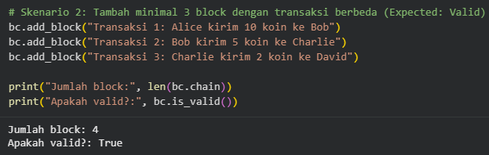
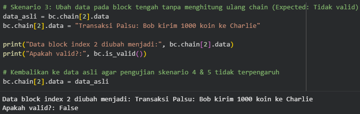
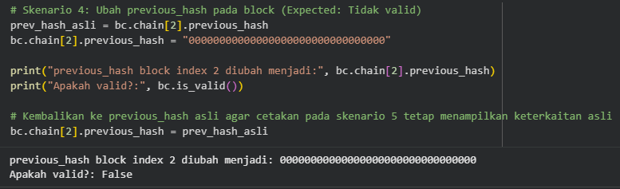
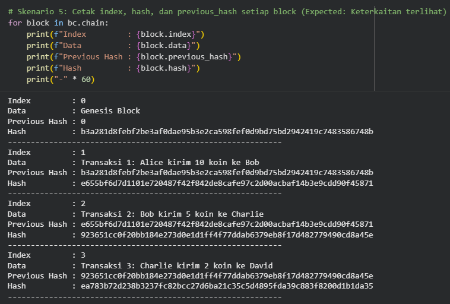

# Tugas 4 - Implementasi Blockchain Sederhana dengan Python

- **Nama**: Stefanus Dimas Freynando Gabriel
- **NIM**: 1003240022
- **Prodi**: Informatika

## 1. Desain Singkat Program
Program ini terdiri dari 2 class utama
- **Block**: Merepresentasikan satu blok di dalam rantai yang menyimpan atribut index, timestamp, data, previous_hash, dan hash. Nilai hash dihitung secara deterministik menggunakan algoritma kriptografi SHA-256 (calculate_hash()) dari seluruh isi blok yang diserialisasi ke format JSON.

  
- **Blockchain**: Mengelola rantai blok (self.chain) yang diawali secara otomatis oleh Genesis Block (create_genesis_block()). Dilengkapi dengan fungsi latest_block() untuk mengambil blok terakhir, add_block(data) untuk menambahkan blok baru yang terhubung ke hash blok sebelumnya, serta is_valid() untuk memvalidasi keutuhan seluruh rantai.

## 2. Cara Menjalankan Program
1. Buka file notebook (.ipynb) menggunakan Google Colab (atau jalankan file .py menggunakan Python 3).
2. Jalankan Cell 1 terlebih dahulu untuk memuat definisi class Block dan Blockchain.
3. Jalankan Cell 2 hingga Cell 6 secara berurutan untuk mengeksekusi Skenario Pengujian 1 sampai 5.

## 3. Mengapa Tampering Dapat Dideteksi?

Tampering (manipulasi data) dapat dideteksi oleh fungsi is_valid() karena dua mekanisme utama:

1. Sifat Deterministik & Avalanche Effect pada SHA-256: Setiap perubahan sekecil apa pun pada data atau atribut di dalam blok akan menghasilkan nilai hash baru yang sama sekali berbeda ketika calculate_hash() dipanggil ulang. Karena nilai block.hash yang tersimpan tidak lagi cocok dengan hasil block.calculate_hash(), manipulasi langsung terdeteksi.

2. Keterkaitan Rantai (previous_hash): Setiap blok menyimpan hash dari blok tepat di depannya pada atribut previous_hash. Jika previous_hash diubah atau blok sebelumnya dimodifikasi, maka nilai current_block.previous_hash != prev_block.hash sehingga rantai terputus dan dinyatakan tidak valid (False).

## 4. Bukti Hasil Pengerjaan
- **Starter Code**

- **Skenario 1 - Chain baru hanya memiliki genesis block**

- **Skenario 2 - Tambah minimal 3 block dengan transaksi berbeda**

- **Skenario 3 - Ubah data pada block tengah tanpa menghitung ulang chain**

- **Skenario 4 - Ubah previous_hash pada block**

- **Skenario 5 - Cetak index, hash, dan previous_hash setiap block**

